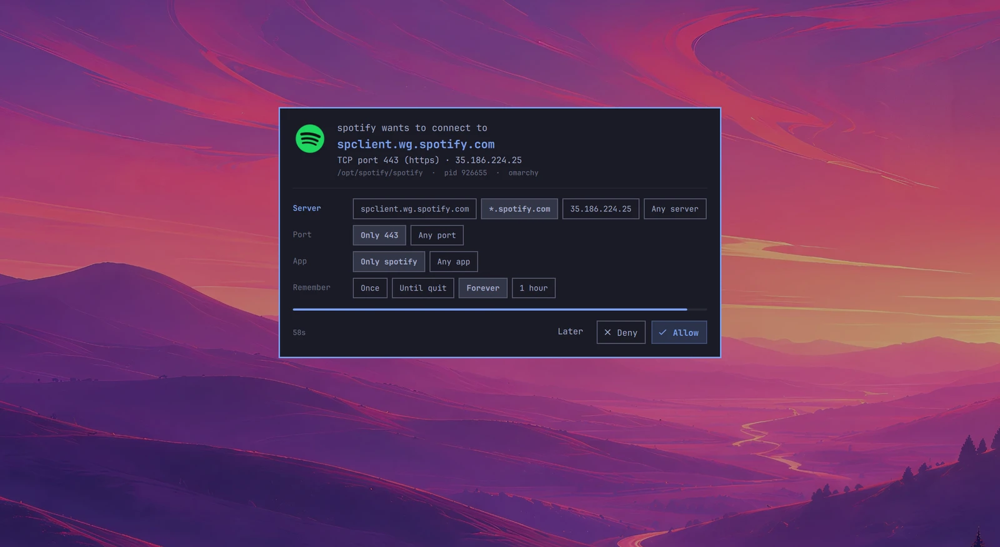
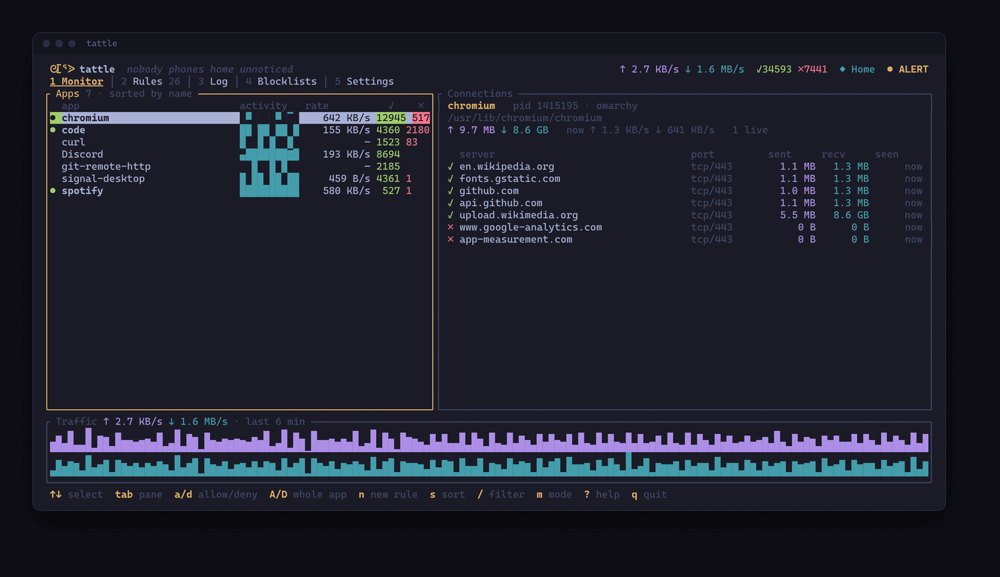
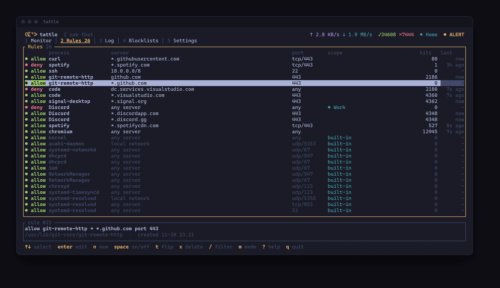
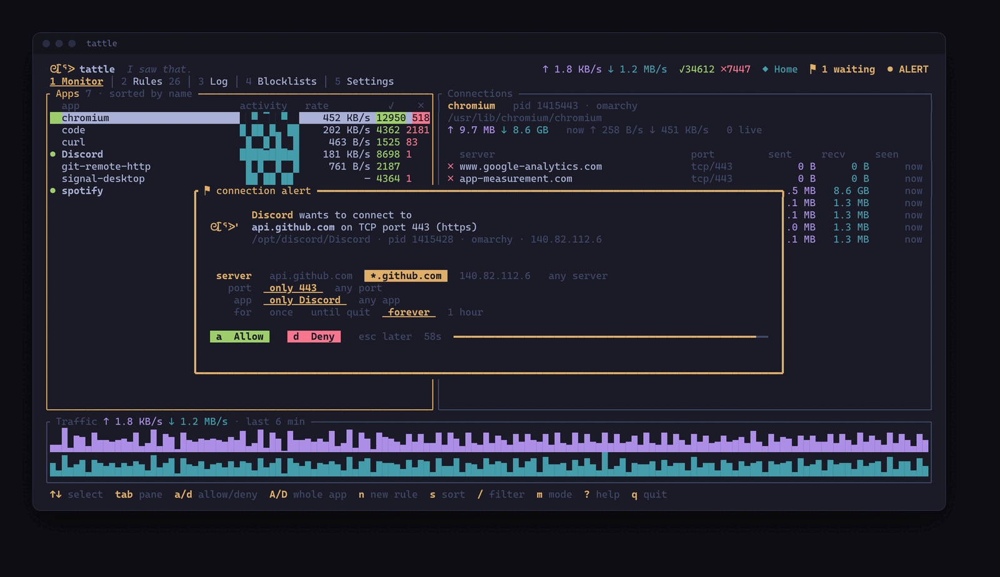

<div align="center">

# ᘛ⁐ᕐᐷ Tattle

**An application firewall for Linux that tells you who's phoning home.**

[](https://github.com/jonaylor89/tattle/actions/workflows/ci.yml)
[](https://github.com/jonaylor89/tattle/releases)
[](LICENSE)



</div>

Built for [Omarchy](https://omarchy.org), in the spirit of Little Snitch: when an app
makes a connection no rule covers, Tattle stops it and asks you, right on your
desktop, and remembers your answer.

<table>
<tr>
<td width="38%"></td>
<td></td>
</tr>
<tr>
<td align="center"><sub>The bar panel</sub></td>
<td align="center"><sub><code>tattle</code>: the full monitor</sub></td>
</tr>
</table>

## Features

- **Connection alerts**: a native Omarchy shell overlay. It names the app, the server
  (as a host name, not just an IP), and the port, and lets you choose the scope:
  *this host / the whole domain / this IP / any server*, *this port / any port*,
  *this app / any app*, for *once / until the app quits / forever / 1 hour*.
- **Live traffic monitor**: per-app bytes and rates from the kernel's own
  connection tracker, per-server breakdowns, and a traffic graph.
- **Rules**: allow and deny by app, host, domain, IP/CIDR, local network, port and port
  range, protocol, direction, user, and profile, with optional expiry.
- **Silent modes**: allow or deny everything unknown without asking (all of it still
  logged), or switch filtering off entirely.
- **Profiles**: *Home*, *Work*, *Public Wi-Fi*, or your own. Rules can apply to one
  profile only.
- **Blocklists**: subscribe to ad, tracker and malware lists (HaGeZi and StevenBlack
  presets, or any hosts, plain-domain or `||domain^` list). They refresh automatically
  and are cached for offline boots.
- **Inbound filtering** (optional): ask before anything reaches a listening service.
- **Script-aware**: `python3 sync.py` and `python3 -m http.server` are different
  apps, so allowing one Python tool doesn't allow them all.
- **Fails safe for your machine**: if the daemon stops, traffic flows normally
  (NFQUEUE bypass). Denied connections fail instantly (TCP reset / ICMP
  unreachable) instead of hanging.

It comes in three parts:

| Part | What it is |
|---|---|
| `tattle daemon` | The firewall: a root systemd service (nftables + NFQUEUE) |
| Omarchy plugin | An eye icon in the bar, a quick panel, and the alert overlay |
| `tattle` | The full-screen monitor (a TUI) and a scriptable CLI |

One static Rust binary does all three; the plugin is plain QML that talks to it.

## Install

### On Omarchy

```bash
omarchy plugin add https://github.com/jonaylor89/tattle --enable
```

Click the new 󰈉 eye in your bar and press **Set up tattle**. That runs
[`install.sh`](install.sh) in a terminal: it fetches the release binary (or builds
from source), installs `/usr/bin/tattle` and `tattle.service`, and starts it. The eye
opens 󰈈 when Tattle is watching.

### By hand

```bash
git clone https://github.com/jonaylor89/tattle && cd tattle
bash install.sh            # or: bash install.sh --source
```

Or build the Arch package: `cd packaging/arch && makepkg -si`, then
`sudo systemctl enable --now tattle`.

Controlling Tattle requires membership in the `wheel` group (Omarchy's default user
already has it).

## Using it

### Alerts

When something new connects, the alert card appears:

| Key | Action |
|---|---|
| `a` / `d` | Allow / deny |
| `↑↓` | Pick a row (server, port, app, duration) |
| `←→` | Change that row's choice |
| `Esc` | Decide later. The connection waits; the eye shows a red dot, and the panel can bring the card back. |

Unanswered alerts get the *timeout action* (deny, by default) after 60 seconds.
Keystrokes in the first 0.7 s are ignored, so typing never answers an alert by
accident. You can also answer from a keybinding:

```
omarchy-shell tattle-alerts allow    # or deny, show, hide
```

### The bar

- **Left click**: the panel (filtering switch, mode, profile, live traffic, recent
  blocks)
- **Right click**: toggle filtering
- **Middle click**: open the monitor

Panel keys: `f` filter on/off, `m` cycle mode, `o` open monitor, `a` show waiting
alerts. `omarchy-shell tattle toggle` opens it from a keybinding.

### The monitor

Run `tattle`. It follows your Omarchy theme (it uses your terminal's palette).

| Tab | |
|---|---|
| **1 Monitor** | Apps with live activity sparklines; pick one to see each server it talked to. `a`/`d` allows or denies the selected server, `A`/`D` the whole app. |
| **2 Rules** | Every rule with hit counts. `n` new, `enter` edit, `space` enable/disable, `t` flip allow/deny, `x` delete. |
| **3 Log** | Every decision, live. `b` shows denied only; `a`/`d` turns a line into a rule. |
| **4 Blocklists** | `p` subscribes to a well-known list, `n` adds your own. |
| **5 Settings** | Mode, profiles, timeouts, inbound filtering, and resets. |



`/` filters any list, `m` cycles the mode, `?` shows help. The monitor answers alerts
too, which is handy over SSH or outside Omarchy:



### The CLI

```bash
tattle status
tattle mode silent-deny                     # alert | silent-allow | silent-deny
tattle off / tattle on
tattle allow firefox                        # firefox may connect anywhere
tattle deny '*' '*.doubleclick.net'         # nothing may reach this domain
tattle allow /usr/bin/ssh 10.0.0.0/8 -p 22
tattle allow curl api.github.com --for 2h   # expires
tattle deny spotify --profile Work
tattle rules / tattle rm 42
tattle log -f                               # live connection log
tattle apps                                 # per-app traffic
tattle blocklist presets / tattle blocklist preset 1
tattle profile Work
tattle export > rules.json / tattle import rules.json
```

## How rules are chosen

When several rules match, the most specific one wins, checked in this order:

1. **Server**: exact host › domain (deeper wins) › IP network (longer prefix wins) ›
   local network › any server
2. **Port**: one port › a range › any port
3. **App**: one app › any app
4. **User**: one user › everyone
5. **Origin**: your rules › blocklists and built-ins
6. **Action**: deny › allow

So *"deny everything → \*.tracker.com"* beats *"allow Firefox → anywhere"*, and an
explicit *"allow → ads.example.com"* punches a hole in a blocklist.

Tattle ships a handful of built-in rules so a fresh install stays online: DNS
(systemd-resolved), DHCP (NetworkManager, iwd, dhcpcd, systemd-networkd), time sync,
mDNS, and kernel-originated traffic such as WireGuard. You can edit or disable them,
and *Settings → Restore built-in rules* brings them back.

## How it works

```
 app ──connect()──► nftables (table inet tattle)
                     │ ct state new ─► NFQUEUE 4200 ─┐
                     │ udp sport 53 ─► NFQUEUE 4201 ─┤ (DNS answers: learn host names)
                                                     ▼
                                               tattle daemon
             sock_diag + /proc: which process? ◄─────┤
             rules › blocklists › mode ◄─────────────┤
             ask: alert overlay / TUI ◄── /run/tattle/tattle.sock (JSON lines)
             conntrack: bytes per flow ──► per-app traffic
                     │
          verdict: accept, or repeat-with-mark ─► reject (TCP RST / ICMP)
```

- Only the first packet of each new flow goes to userspace; everything else stays
  in the kernel fast path.
- Process attribution looks the packet's 5-tuple up with `sock_diag` (exact lookups
  for TCP, including IPv4-mapped dual-stack sockets), then maps the socket inode to a
  process through `/proc`. A most-recently-used cache keeps that fast.
- Host names come from watching DNS answers (including the CNAME chain) before
  they reach your resolver. Only answers that chain back to the question asked are
  trusted.
- Packets waiting on an alert are held in the queue and grouped, so retransmits and
  parallel requests produce one alert.
- Rules and settings live in `/var/lib/tattle/*.json`, written atomically.

## Security notes

- The control socket is `root:wheel 0660`, and every connecting process's
  credentials are checked again (`SO_PEERCRED` plus supplementary groups).
- Everything shown in the shell plugin is treated as untrusted (DNS names are
  attacker-controlled) and rendered as plain text, length-bounded.
- Blocklists download over HTTPS only, through `curl` with size and time limits. They
  are parsed as data, never executed.
- The service runs with a reduced capability set and systemd sandboxing; see
  [`packaging/tattle.service`](packaging/tattle.service).

## Limitations

- An app that does its own DNS (DNS-over-HTTPS in browsers) shows IP addresses
  instead of names until something else resolves them. Pointing the browser at the
  system resolver fixes this.
- AppImages run from a random mount path each launch, so their rules don't stick.
  Use a stable path or an *any-app* rule.
- Traffic from containers and VMs is forwarded, not local, so Tattle doesn't
  filter it.
- Attribution reads `/proc` after the first packet. A process that sends one UDP
  datagram and exits immediately may show up as `kernel`.

## Development

```bash
cargo test                 # includes real kernel sock_diag round trips
cargo clippy -- -D warnings
```

You can run the whole daemon unprivileged inside a throwaway network namespace;
the end-to-end tests are done this way:

```bash
unshare -rn bash -c '
  ip link set lo up
  export TATTLE_SOCKET=/tmp/tattle-test.sock
  ./target/debug/tattle daemon --state-dir /tmp/tattle-state \
      --socket $TATTLE_SOCKET --include-loopback &
  sleep 0.5; ./target/debug/tattle'
```

The plugin honours `TATTLE_SOCKET`, and `TATTLE_ALERT_TEST=1` stops the alert from
taking keyboard focus while you iterate on it.

## Uninstall

```bash
bash uninstall.sh          # keeps your rules; --purge removes them
omarchy plugin remove tattle
```

## Acknowledgements

Inspired by [Little Snitch](https://www.obdev.at/products/littlesnitch/) (not affiliated) and
[OpenSnitch](https://github.com/evilsocket/opensnitch). Blocklists are maintained by
[HaGeZi](https://github.com/hagezi/dns-blocklists) and [StevenBlack](https://github.com/StevenBlack/hosts).
The screenshots show a scripted demo session in the default *Tokyo Night* theme.

## License

MIT
