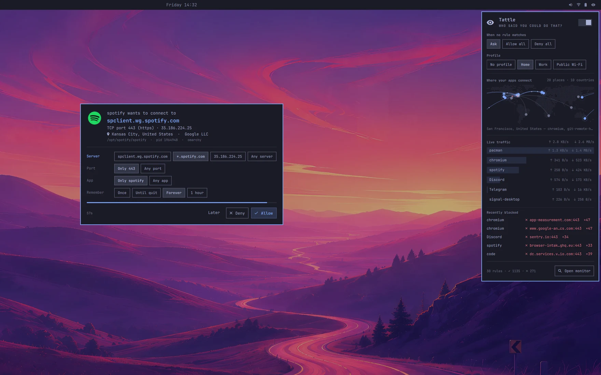
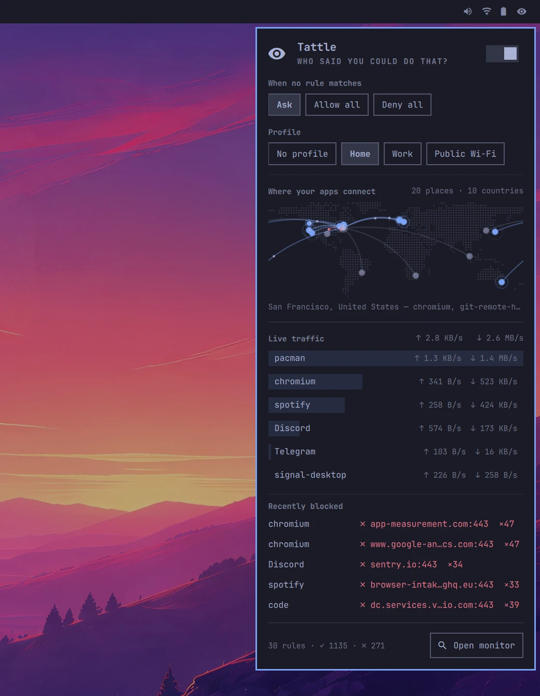
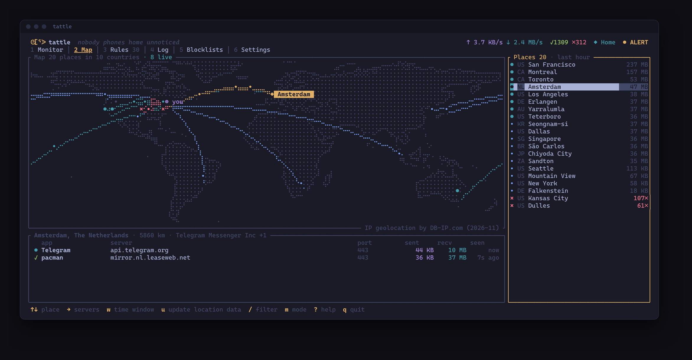

<div align="center">

# ᘛ⁐ᕐᐷ Tattle

**An application firewall for Linux that tells you who's phoning home.**

[](https://github.com/jonaylor89/tattle/actions/workflows/ci.yml)
[](https://github.com/jonaylor89/tattle/releases)
[](LICENSE)



</div>

Built for [Omarchy](https://omarchy.org), in the spirit of Little Snitch: when an app
makes a connection no rule covers, Tattle stops it and asks you, right on your
desktop, and remembers your answer.

<table>
<tr>
<td width="38%"></td>
<td></td>
</tr>
<tr>
<td align="center"><sub>The bar panel</sub></td>
<td align="center"><sub><code>tattle</code>: the full monitor</sub></td>
</tr>
</table>

## Features

- **Connection alerts**: a native Omarchy shell overlay. It names the app, the server
  (as a host name, not just an IP), and the port, and lets you choose the scope:
  *this host / the whole domain / this IP / any server*, *this port / any port*,
  *this app / any app*, for *once / until the app quits / forever / 1 hour*.
- **Live traffic monitor**: per-app bytes and rates from the kernel's own
  connection tracker, per-server breakdowns, and a traffic graph.
- **World map**: every place your apps talk to, with an arc from you to each one,
  packets in flight, and blocked connections in red. Pick a place to see which
  apps reach which servers there, and who owns the network. Alerts say where a
  server is, too. Location lookups are offline, on your machine.
- **Rules**: allow and deny by app, host, domain, IP/CIDR, local network, port and port
  range, protocol, direction, user, and profile, with optional expiry.
- **Silent modes**: allow or deny everything unknown without asking (all of it still
  logged), or switch filtering off entirely.
- **Profiles**: *Home*, *Work*, *Public Wi-Fi*, or your own. Rules can apply to one
  profile only.
- **Blocklists**: subscribe to ad, tracker and malware lists (HaGeZi and StevenBlack
  presets, or any hosts, plain-domain or `||domain^` list). They refresh automatically
  and are cached for offline boots.
- **Inbound filtering** (optional): ask before anything reaches a listening service.
- **Script-aware**: `python3 sync.py` and `python3 -m http.server` are different
  apps, so allowing one Python tool doesn't allow them all.
- **Fails safe for your machine**: if the daemon stops, traffic flows normally
  (NFQUEUE bypass). Denied connections fail instantly (TCP reset / ICMP
  unreachable) instead of hanging.

It comes in three parts:

| Part | What it is |
|---|---|
| `tattle daemon` | The firewall: a root systemd service (nftables + NFQUEUE) |
| Omarchy plugin | An eye icon in the bar, a quick panel, and the alert overlay |
| `tattle` | The full-screen monitor (a TUI) and a scriptable CLI |

One static Rust binary does all three; the plugin is plain QML that talks to it.

## Install

### On Omarchy

```bash
omarchy plugin add https://github.com/jonaylor89/tattle --enable
```

Click the new 󰈉 eye in your bar and press **Set up tattle**. That runs
[`install.sh`](install.sh) in a terminal: it gets the binary, installs
`/usr/bin/tattle` and `tattle.service`, and starts it. The eye opens 󰈈 when Tattle
is watching.

**Where the binary comes from.** The daemon runs as root, so `install.sh` only
runs a binary tied to the checkout you installed. It downloads the release
matching the version in `Cargo.toml` (never "latest") and checks it against a
SHA-256 committed in this repository under
[`packaging/checksums/`](packaging/checksums). The hash is not read from the
release, which could be edited after the fact. If the checkout has no pinned
hash for your architecture, the download fails, or you pass `--source`, it builds
from this checkout with `cargo build --release --locked` instead. Release
binaries are built by [CI](.github/workflows/ci.yml) from the tag and carry
GitHub build provenance, which you can check yourself:
`gh attestation verify tattle-x86_64-linux -R jonaylor89/tattle`.

### By hand

```bash
git clone https://github.com/jonaylor89/tattle && cd tattle
bash install.sh            # or: bash install.sh --source
```

Or build the Arch package: `cd packaging/arch && makepkg -si`, then
`sudo systemctl enable --now tattle`. Pick one route: `install.sh` refuses to
overwrite a pacman-installed tattle; update that one with pacman.

Controlling Tattle requires membership in the `wheel` group (Omarchy's default user
already has it).

**Requirements:** Linux with nftables (`nft`), systemd and curl, all present on
Omarchy. Building from source needs Rust. The map's location database is optional
and downloaded only when you ask for it ([below](#the-map)).

## Using it

### Alerts

When something new connects, the alert card appears:

| Key | Action |
|---|---|
| `a` / `d` | Allow / deny |
| `↑↓` | Pick a row (server, port, app, duration) |
| `←→` | Change that row's choice |
| `Esc` | Decide later. The connection waits; the eye shows a red dot, and the panel can bring the card back. |

Unanswered alerts get the *timeout action* (deny, by default) after 60 seconds.
Keystrokes in the first 0.7 s are ignored, so typing never answers an alert by
accident. You can also answer from a keybinding:

```
omarchy-shell tattle-alerts allow    # or deny, show, hide
```

### The bar

- **Left click**: the panel (filtering switch, mode, profile, live traffic, recent
  blocks)
- **Right click**: toggle filtering
- **Middle click**: open the monitor

Panel keys: `f` filter on/off, `m` cycle mode, `o` open monitor, `a` show waiting
alerts. `omarchy-shell tattle toggle` opens it from a keybinding.

### The monitor

Run `tattle`. It follows your Omarchy theme (it uses your terminal's palette).

| Tab | |
|---|---|
| **1 Monitor** | Apps with live activity sparklines; pick one to see each server it talked to. `a`/`d` allows or denies the selected server, `A`/`D` the whole app. |
| **2 Map** | Where your apps connect. `↑↓` picks a place, `→` its servers (`a`/`d` makes a rule), `w` changes the time window. |
| **3 Rules** | Every rule with hit counts. `n` new, `enter` edit, `space` enable/disable, `t` flip allow/deny, `x` delete. |
| **4 Log** | Every decision, live. `b` shows denied only; `a`/`d` turns a line into a rule. |
| **5 Blocklists** | `p` subscribes to a well-known list, `n` adds your own. |
| **6 Settings** | Mode, profiles, timeouts, inbound filtering, and resets. |




`/` filters any list, `m` cycles the mode, `?` shows help. The monitor answers alerts
too, which is handy over SSH or outside Omarchy:


### The map

The map needs to know where IP addresses are. Tattle never asks an online service
for that (that would tell a third party every server you talk to). It reads an
offline database instead:

```bash
tattle geo update      # download DB-IP City Lite (free, CC BY 4.0, ~60 MB), refreshed monthly
tattle geo             # what's installed, and where the map puts you
tattle geo locate 1.1.1.1
tattle geo home 52.52,13.40   # the map puts you in your time zone's city by default
```

The download is the only time Tattle contacts anyone, and only when you ask
(`u` on the Map tab or **Get it** in the panel do the same). If you already keep
a MaxMind GeoLite2-City database in `/usr/share/GeoIP` or `/var/lib/GeoIP`
(for example with `geoipupdate`), Tattle uses that instead.

`tattle map` opens the monitor on the map; `tattle map --list` prints the
places as a table.

### The CLI

```bash
tattle status
tattle mode silent-deny                     # alert | silent-allow | silent-deny
tattle off / tattle on
tattle allow firefox                        # firefox may connect anywhere
tattle deny '*' '*.doubleclick.net'         # nothing may reach this domain
tattle allow /usr/bin/ssh 10.0.0.0/8 -p 22
tattle allow curl api.github.com --for 2h   # expires
tattle deny spotify --profile Work
tattle rules / tattle rm 42
tattle log -f                               # live connection log
tattle apps                                 # per-app traffic
tattle blocklist presets / tattle blocklist preset 1
tattle profile Work
tattle export > rules.json / tattle import rules.json
tattle map --list                           # where your apps connect
tattle geo locate 140.82.112.3              # offline: San Francisco, GitHub, Inc.
```

## How rules are chosen

When several rules match, the most specific one wins, checked in this order:

1. **Server**: exact host › domain (deeper wins) › IP network (longer prefix wins) ›
   local network › any server
2. **Port**: one port › a range › any port
3. **App**: one app › any app
4. **User**: one user › everyone
5. **Origin**: your rules › blocklists and built-ins
6. **Action**: deny › allow

So *"deny everything → \*.tracker.com"* beats *"allow Firefox → anywhere"*, and an
explicit *"allow → ads.example.com"* punches a hole in a blocklist.

Tattle ships a handful of built-in rules so a fresh install stays online: DNS
(systemd-resolved), DHCP (NetworkManager, iwd, dhcpcd, systemd-networkd), time sync,
mDNS, and kernel-originated traffic such as WireGuard. You can edit or disable them,
and *Settings → Restore built-in rules* brings them back.

## How it works

```
 app ──connect()──► nftables (table inet tattle)
                     │ ct state new ─► NFQUEUE 4200 ─┐
                     │ udp sport 53 ─► NFQUEUE 4201 ─┤ (DNS answers: learn host names)
                                                     ▼
                                               tattle daemon
             sock_diag + /proc: which process? ◄─────┤
             rules › blocklists › mode ◄─────────────┤
             ask: alert overlay / TUI ◄── /run/tattle/tattle.sock (JSON lines)
             conntrack: bytes per flow ──► per-app traffic
                     │
          verdict: accept, or repeat-with-mark ─► reject (TCP RST / ICMP)
```

- Only the first packet of each new flow goes to userspace; everything else stays
  in the kernel fast path.
- Process attribution looks the packet's 5-tuple up with `sock_diag` (exact lookups
  for TCP, including IPv4-mapped dual-stack sockets), then maps the socket inode to a
  process through `/proc`. A most-recently-used cache keeps that fast.
- Host names come from watching DNS answers (including the CNAME chain) before
  they reach your resolver. Only answers that chain back to the question asked are
  trusted.
- Packets waiting on an alert are held in the queue and grouped, so retransmits and
  parallel requests produce one alert.
- Rules and settings live in `/var/lib/tattle/*.json`, written atomically.
- Locations come from a memory-mapped MaxMind-format database, so a lookup takes
  microseconds and the daemon's memory barely grows. The map's coastlines are a
  half-degree land mask rasterized from Natural Earth
  ([`tools/gen-land.py`](tools/gen-land.py)).

## Security notes

- The control socket is `root:wheel 0660`, and every connecting process's
  credentials are checked again (`SO_PEERCRED` plus supplementary groups).
- Everything shown in the shell plugin is treated as untrusted (DNS names are
  attacker-controlled) and rendered as plain text, length-bounded.
- Blocklists download over HTTPS only, through `curl` with size and time limits. They
  are parsed as data, never executed.
- The service runs with a reduced capability set and systemd sandboxing; see
  [`packaging/tattle.service`](packaging/tattle.service).
- Rules and settings are written atomically (temp file, fsync, rename). If a change
  can't be saved, it is rolled back and the request fails, so what's enforced
  always matches what survives a restart. A saved file that can't be parsed is
  moved aside, never overwritten; one that can't be read at all stops the
  daemon from starting rather than falling back to defaults.

## Limitations

- An app that does its own DNS (DNS-over-HTTPS in browsers) shows IP addresses
  instead of names until something else resolves them. Pointing the browser at the
  system resolver fixes this.
- AppImages run from a random mount path each launch, so their rules don't stick.
  Use a stable path or an *any-app* rule.
- Traffic from containers and VMs is forwarded, not local, so Tattle doesn't
  filter it.
- Attribution reads `/proc` after the first packet. A process that sends one UDP
  datagram and exits immediately may show up as `kernel`.

## Development

```bash
cargo test                 # includes real kernel sock_diag round trips
cargo clippy -- -D warnings
```

You can run the whole daemon unprivileged inside a throwaway network namespace;
the end-to-end tests are done this way:

```bash
unshare -rn bash -c '
  ip link set lo up
  export TATTLE_SOCKET=/tmp/tattle-test.sock
  ./target/debug/tattle daemon --state-dir /tmp/tattle-state \
      --socket $TATTLE_SOCKET --include-loopback &
  sleep 0.5; ./target/debug/tattle'
```

The plugin honours `TATTLE_SOCKET`, and `TATTLE_ALERT_TEST=1` stops the alert from
taking keyboard focus while you iterate on it.

### Releasing

Releases are automated with [release-plz](https://release-plz.dev)
([workflow](.github/workflows/release-plz.yml)):

1. Every push to `main` opens or updates a release PR that bumps `Cargo.toml` and
   `CHANGELOG.md`.
2. Merging it tags `v<version>` and creates the GitHub release. The same workflow
   builds both static binaries from the tag, attests their provenance, and uploads
   them.
3. It then opens a *Pin v&lt;version&gt;* PR with the binaries' SHA-256 in
   `packaging/checksums/` and the version synced into `manifest.json` and the
   PKGBUILD. Until that's merged, `install.sh` builds from source.

## Uninstall

```bash
bash uninstall.sh          # keeps your rules; --purge removes them
omarchy plugin remove jonaylor89.tattle
```

If you installed the Arch package, `uninstall.sh` removes it with `pacman -R`, so
pacman's records stay correct; `sudo pacman -R tattle` does the same.

## Acknowledgements

Inspired by [Little Snitch](https://www.obdev.at/products/littlesnitch/) (not affiliated) and
[OpenSnitch](https://github.com/evilsocket/opensnitch). Blocklists are maintained by
[HaGeZi](https://github.com/hagezi/dns-blocklists) and [StevenBlack](https://github.com/StevenBlack/hosts).
[IP geolocation by DB-IP](https://db-ip.com) (CC BY 4.0, downloaded on request, not bundled).
Map outlines from [Natural Earth](https://www.naturalearthdata.com) (public domain).
The screenshots show a scripted demo session in the default *Tokyo Night* theme.

## License

MIT
